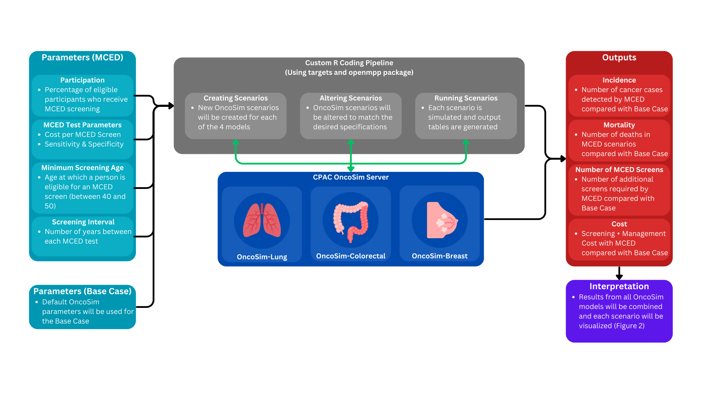
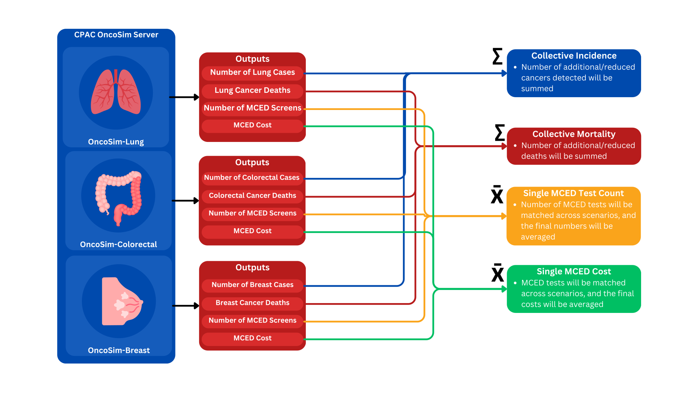
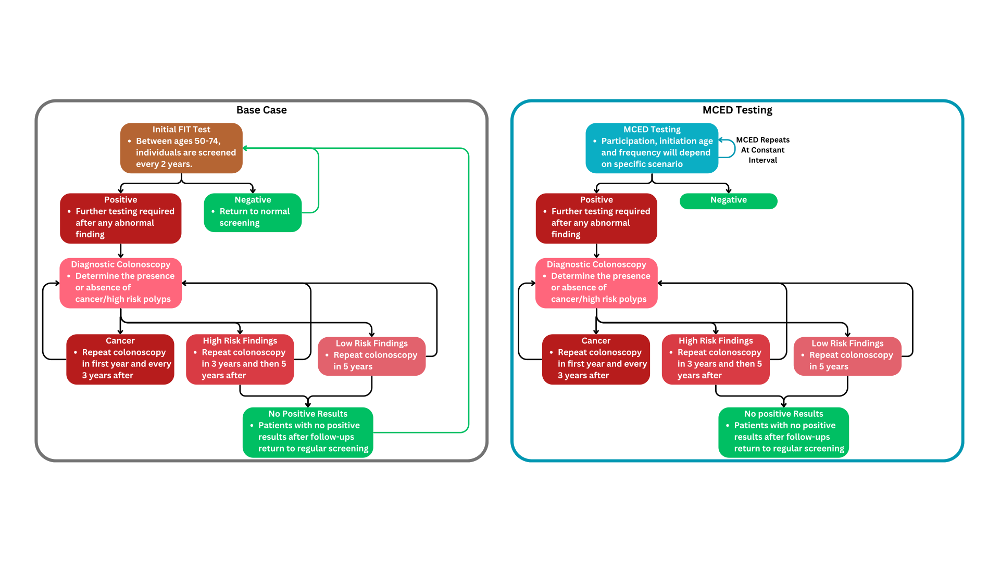
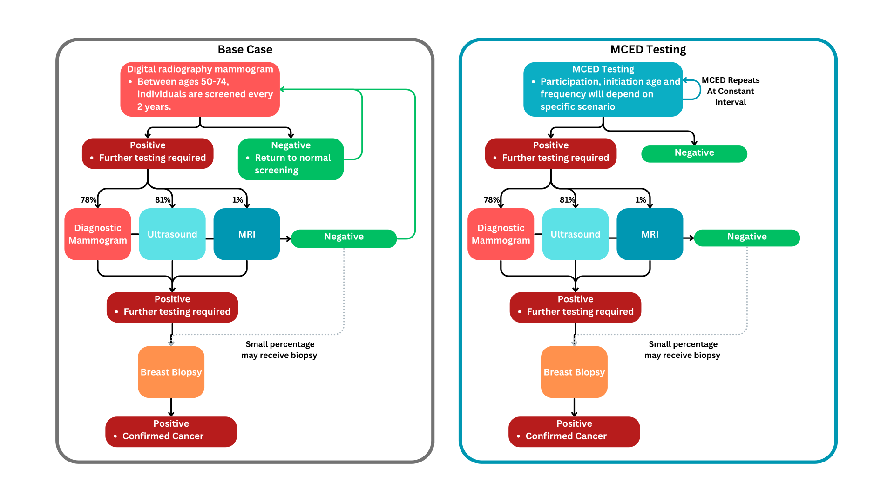
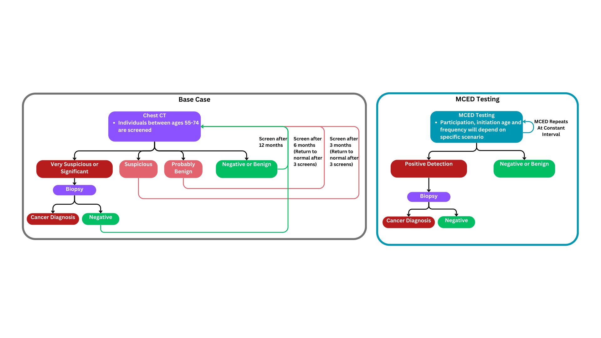

```{r}
#| echo: false
#| warning: false
library(tidyverse)
library(targets)
library(ggplot2)
library(extrafont)
library(RColorBrewer)
library(ggpubr)
library(ggrepel)

combinedTables <- tar_read(combinedTables, store = "store_visualize")

source("R/Visualization_PlotFunctions.R")

# extrafont::font_import()
extrafont::loadfonts()

scenariosToVisualize <- c("50_3_70_CancerSeek", "50_3_70_Galleri", "50_3_70_NonMCED", "45_1_90_CancerSeek", "45_1_90_Galleri", "45_1_90_NonMCED", "BaseCase")


# scenariosToVisualize <- c("50_3_30_CancerSeek", "45_1_90_CancerSeek", "BaseCase")

timeData <- combinedTables$PrimaryTable # %>% filter(sce %in% scenariosToVisualize)
timeData$formattedName <- paste(timeData$formattedName, "\n")

totalData <- combinedTables$`PrimaryTable_2025-2051` # %>% filter(sce %in% scenariosToVisualize)
totalData$formattedName <- paste(totalData$formattedName, "\n")


stageData <- combinedTables$StageDist # %>% filter(sce %in% scenariosToVisualize)
stageData$formattedName <- paste(stageData$formattedName, "\n")

timeData_BreastDouble <- timeData
timeData_BreastDouble$Total_Screens[timeData$cancertype == "Breast"] <- timeData_BreastDouble$Total_Screens[timeData$cancertype == "Breast"] * 2

participationData <- combinedTables$Participation

```


# NOTE

* These have been generated with only 300K simulation cases (We plan to use 46 Million) for efficiency
  + The contained results WILL change before the final project
* Let me know whatever other visuals should be generated
* The NonMCED scenarios (using existing screening, with the programming of MCED) seems to always be more efficient, so they have been excluded from those visuals
* The efficiency frontiers very likely have issues. We will need to discuss the best way to make them

# Changes to Make

* Switch to using HAPY per person for efficiency frontiers
  + Results seem counterintuitive when doing this. Will explain when we meet
* Refine existing visuals
* Generate further visuals using feedback
* Run with full simulation cases

# Outline

- Introduction
- Research Aim and Primary Objectives
- Methods
- Scenario Construction
- Current Results
- Discussion

# Introduction - Benefits of Cancer Screening

* 45% of Canadians are expected to be diagnosed with cancer, and 22% are expected to die from cancer (1,2)
* Based on previous successes in cancer mitigation, cancer screening is seen as a promising method to reduce late-stage cancers (3)
  + Cancer screening can come at a large cost to healthcare providers
  + However, the reductions in future cancer burden can render it economically viable (4)

# Introduction - What Gaps Exist in Screening? 

* Screening programs are showing below-target participation 
(5-7)
* Individuals below 50 have increasing cancer rates, but are not frequently screened
* Certain screening procedures can cause discomfort or embarrassment (7,9)
* Screening in rural areas can be difficult (7,11)
* Cancer is only detected in single organ systems (7)

# Introduction - Multi Cancer Early Detection Testing (MCED)

* MCED testing relies on identifying cancer signals (genetic signatures, methylation etc.) within a blood sample and using this to determine the presence and tissue of origin (TOO) of the cancer (7,18)
* Previous studies, such as the NHS Galleri trial and the PATHFINDER study, have recruited large populations (16,20)
* Evidence in other jurisdictions are promising, but there is little evidence within Canada

# Introduction - How Does MCED Address Gaps in Cancer Screening?

* Screening programs are showing below-target participation 
(5-7)
  + Patients tend to have favourable opinions of MCED, which may encourage participation (7,21)

* Individuals below 50 have increasing cancer rates, but are not frequently screened
  + A new MCED program could include younger individuals
* Certain screening procedures can cause discomfort or embarrassment (7,9)
  + MCED is not invasive and only needs a blood test (7)
* Screening in rural areas can be difficult (7,11)
  + Blood tests could be collected and transported to centralized testing facilities
* Cancer is only detected in single organ systems (7)
  + MCED detects cancer across several organ systems with a single test (7)

# Introduction - Potential Drawbacks Involved with MCED

* MCED is Expensive and Complicated
* False Positives may be difficult to resolve
* Not all detections are useful

# Research Aim
* The literature review demonstrates that MCED is a promising technology for future cancer screening
* Further evaluation within Canada would be required to determine its effectiveness
* Simulation could allow us to predict the impact of introducing MCED in Canada

# Objectives & Research Questions
* The primary objective of this study is to evaluate MCED across Canada using microsimulation, where the main outcomes will be change in incidence, mortality and cost, compared to existing methods
* Research Questions:
  + 1.	Will MCED screening be an effective and economically viable form of cancer screening for screening-age adults in Canada? 
  + 2.	Which MCED parameters (test provider, participation, initiation age etc.) will result in the fewest deaths from cancer with the smallest increase in overall cost?


# Methods - Study Design and Setting

* 32 million simulation cases representing all provinces and territories will be used
* Any screening changes will occur in 2025 and will be continued until the end of the simulation

# Methods - Simulation



# Methods - Analysis



# Methods - Specific Scenarios

Parameter|Description|Planned Values|
|--------|-----------|--------------|
|Participation|Probability that an eligible patient will participate in MCED screening.|Values ranging between 30% and 90% |
|MCED Test|Specific MCED test sensitivity/specificity and cost.|Galleri and CancerSEEK. Plus a NonMCED scenario|
|Minimum Screening Age|Minimum age when patients will be recruited for MCED screening.|45 and 50 years of age|
|Screening Interval|How many years between each MCED screen performed, per patient.|1 years and 3 years|

# Methods - Specific Scenarios

- For each cancer type (Colorectal, Breast, Lung)
  + 4 Participation values (30%, 50%, 70%, 90%)
  + 2 MCED Tests (Galleri and CancerSeek) + a Fake MCED Test (NonMCED)
  + 2 Minimum Screening Ages (45 and 50 years old)
  + 2 Screening Intervals (1 year and 3 years)
  + Plus one base case scenario
  + (4*3*2*2) + 1 = 49
- A total of 147 scenarios for the entire project.


# Methods Parameters

|Model|Galleri|CancerSeek|
|-----|-------|----------|
|Colorectal (Sensitivity)|82%|64.9%|
|Breast (Sensitivity)|30.5%|33.5%|
|Lung (Sensitivity)|74.8%|58.7%|
|Specificity|99.5%|99%|
|Cost ($ CAD)|$1312.48|$691.50|

# Methods - Overall Assumptions

- Precancerous polyps should not be detected by MCED. Detection is equally as likely with any stage or size of cancerous growth.
  + Specificity and sensitivity parameters are not available for every type of every cancer, so some simplifications must be used.
- Base Case covers screening as it is, with comparable intervals, participation and age groups
- MCED begins in 2025 and replaces all previous forms of screening within the 3 cancer types

# Methods - Sources for Information

- "Clinical validation of a targeted methylation-based multi-cancer early detection test using an independent validation set" Klein et. al
	+ Galleri Sensitivity and Specificty values
- "Detection and localization of surgically resectable cancers with a multi-analyte blood test" Cohen et. al
	+ CancerSeek Sensitivity and Specificity Values
-	Galleri Website
	+ "$949 USD"
-	Multiple outlets (regarding cancerseek)
	+ "$500 USD"

# Methods - Colorectal Assumptions



# Methods - Colorectal Assumptions

- Traditional FIT testing will end in 2025 and MCED testing will start in 2025 (Using FOBT as a substitute)
  + Precancerous polyp positivity is equal to 1 - specificity
- FOBT sensitivity, specificity and cost will be replaced with the above values
- Base Case: Overall participation of 43% (50% ppt with 100% adh was used to achieve this.)


# Methods - Breast Assumptions



# Methods - Breast Assumptions

- Mammogram screening will end in 2025, Alternate Modality E (MCED) will begin at this time
- All tumour sizes are detected equally
- Base Case: Very close to default ~65% participation mammogram screening.

# Methods - Lung Assumptions



# Methods - Lung Assumptions

- Using LungRADS as the screening protocol
- Forced complete eligibility (no difference based on smoking etc.)
- Existing screening is overriden with MCED parameters
  + No transition from regular lung cancer screening (CT) to MCED is simulated.
- Assumed a ~39% participation rate for screening (43% ppt from colorectal, but only in provinces with lung screening). Only high risk participants were screened, so the actual participation ended up as 2.7%


# Methods - Combining Estimates

- Primarily interested in the difference between the MCED scenarios and base case (for each respective model)
- Base Case is all just added together, as there is no shared screening between models
- Cases, Deaths = Add between models
- Total Screens, Screening Cost = Take the mean between models
- Total Cost = sum(Total Cost - ScreeningCost) + mean(Screening Cost)
  + Management cost (total cost - screening) should be model specific. Screening cost should be shared between models
- Stages - Individual distributions between models. No combination
- Note: For the purposes of combining metrics breast resource usage (screening cost, test number etc.) are doubled
+ This is because males should theorectically be receiving the same screening and therefore be using the same number of resources, but are not simulated

# Results - Test Results

- Curently, I have generated some test scenarios using 3 million simulation cases
- This covers 90% ppt/45 years of age/1 year interval and 30% ppt/50 years of age/ 3 year interval
+ These are the most different scenarios, which allowed me to calibrate the models to ensure that both were working properly
- Calibration has gone well. For participation this project, I have prioritized internal consistency between models (similar numbers of screens between models) rather than exact participation values, but final participation values are generally close to what is intended.
  + between 24% - 36% within the past 3 years for the 30% scenario
  + between 83 - 89% within the past year for the 90% scenario


# Calibration - Participation (Breast)

```{r,fig.width=18,fig.height=12}
#| echo: false
#| warning: false

visualizeParticipation(participationData %>% filter(cancertype == "Breast"))

```

# Calibration - Participation (Lung)

```{r,fig.width=18,fig.height=12}
#| echo: false
#| warning: false

visualizeParticipation(participationData %>% filter(cancertype == "Lung"))

```


# Calibration - Participation (Colorectal)

```{r,fig.width=18,fig.height=12}
#| echo: false
#| warning: false

visualizeParticipation(participationData %>% filter(cancertype == "Colorectal"))

```


# Model Specific Results (Breast)

```{r,fig.width=24,fig.height=12}
#| echo: false
#| warning: false
visualizeSpecificCancerType(totalData, "Breast")

```

# Model Specific Results (Colorectal)

```{r,fig.width=24,fig.height=12}
#| echo: false
#| warning: false
visualizeSpecificCancerType(totalData, "Colorectal")

```

# Model Specific Results (Lung)

```{r,fig.width=24,fig.height=12}
#| echo: false
#| warning: false
visualizeSpecificCancerType(totalData, "Lung")

```

# Efficiency Frontier (Excluding NonMCED) Breast

```{r,fig.width=20,fig.height=9}
#| echo: false
#| warning: false

visualizeFrontier(
	combinedTables$`PrimaryTable_2025-2051` %>%
		filter(cancertype == "Breast", testType != "NonMCED")
)

```

# Efficiency Frontier (Excluding NonMCED) Colorectal

```{r,fig.width=20,fig.height=9}
#| echo: false
#| warning: false

visualizeFrontier(
	combinedTables$`PrimaryTable_2025-2051` %>%
		filter(cancertype == "Colorectal", testType != "NonMCED")
)

```


# Efficiency Frontier (Excluding NonMCED) Lung

```{r,fig.width=20,fig.height=9}
#| echo: false
#| warning: false

visualizeFrontier(
	combinedTables$`PrimaryTable_2025-2051` %>%
		filter(cancertype == "Lung", testType != "NonMCED")
)

```


# Efficiency Frontier (Excluding NonMCED) Combined

```{r,fig.width=20,fig.height=9}
#| echo: false
#| warning: false

visualizeFrontier(
	combinedTables$`PrimaryTable_2025-2051` %>%
		filter(cancertype == "Combined", testType != "NonMCED")
)

```

# Results - Number of MCED Screens - Time

```{r,fig.width=24,fig.height=12}
#| echo: false
#| warning: false

visualizeByTime(timeData, "Total_Screens", "Total Screens by Time", "Number of Cancer Screens")


```


# Results - Number of MCED Screens - Total

```{r,fig.width=24,fig.height=12}

MCEDScreenNum <- totalData

MCEDScreenNum$Total_Screens[MCEDScreenNum$cancertype == "Breast" & MCEDScreenNum$testType %in% c("Galleri", "CancerSeek")] <- MCEDScreenNum$Total_Screens[MCEDScreenNum$cancertype == "Breast" & MCEDScreenNum$testType %in% c("Galleri", "CancerSeek")] * 2

visualizeTotals(MCEDScreenNum, "Total_Screens", "Number of Total Screens (2025-2051)", "Number of Cancer Screens (Breast MCED Doubled)")

```


# Results - Number of MCED Screens - Additional

```{r,fig.width=24,fig.height=12}

visualizeTotals(totalData %>% filter(sce != "BaseCase"), "Total_Screens_Diff", "Difference in Total Screens (2025-2051)", "Number of Additional Cancer Screens")

```

# Results - Number of Detected Cancers - Time

```{r,fig.width=24,fig.height=12}
#| echo: false
#| warning: false
visualizeByTime(timeData, "Detected_Cases", "Detected Cases by Time", "Number of Detected Cases")
```

# Results - Number of Detected Cancers - Additional
```{r,fig.width=24,fig.height=12}
#| echo: false
#| warning: false
visualizeTotals(totalData %>% filter(sce != "BaseCase"), "Detected_Cases_Diff", "Difference in Detected Cases (2025-2051)", "Number of Additional Detected Cancers")

```


# Results - Number of Deaths - Time

```{r,fig.width=24,fig.height=12}
#| echo: false
#| warning: false
visualizeByTime(timeData, "Cancer_Deaths", "Deaths by Time", "Number of Deaths")
```

# Results - Number of Deaths - Averted

```{r,fig.width=24,fig.height=12}
#| echo: false
#| warning: false
visualizeTotals(totalData %>% filter(sce != "BaseCase") %>% mutate(Cancer_Deaths_Diff = Cancer_Deaths_Diff * -1), "Cancer_Deaths_Diff", "Difference in Deaths Averted (2025-2051)", "Number of Averted Deaths")

```


# Results - Screening Cost - Time

```{r,fig.width=24,fig.height=12}
#| echo: false
#| warning: false
visualizeByTime(timeData, "Screening_Cost", "Screening Cost by Time", "Screening Cost ($CAD)")
```


# Results - Number of MCED Screens - Total

```{r,fig.width=24,fig.height=12}

MCEDTestCost <- totalData

MCEDScreenNum$Screening_Cost[MCEDScreenNum$cancertype == "Breast" & MCEDScreenNum$testType %in% c("Galleri", "CancerSeek")] <- MCEDScreenNum$Screening_Cost[MCEDScreenNum$cancertype == "Breast" & MCEDScreenNum$testType %in% c("Galleri", "CancerSeek")] * 2

visualizeTotals(MCEDScreenNum, "Screening_Cost", "Screening Cost (2025-2051)", "Screening Cost (Breast MCED Doubled)")

```


# Results - Screening Cost - Additional
```{r,fig.width=24,fig.height=12}
#| echo: false
#| warning: false
visualizeTotals(totalData %>% filter(sce != "BaseCase"), "Screening_Cost_Diff", "Difference in Total Screening Cost", "Additional Screening Cost ($CAD)")
```

# Results - Total Cost - Time

```{r,fig.width=24,fig.height=12}
#| echo: false
#| warning: false
visualizeByTime(timeData, "Total_Cost", "Total Cost by Time", "Total Cost ($CAD)")
```

# Results - Total Cost - Additional
```{r,fig.width=24,fig.height=12}
#| echo: false
#| warning: false
visualizeTotals(totalData %>% filter(sce != "BaseCase"), "Total_Cost_Diff", "Difference in Total Cost", "Difference in Total Cost")

```


# Results - Screening Cost - Time

```{r,fig.width=24,fig.height=12}
#| echo: false
#| warning: false
visualizeByTime(timeData, "Screening_Cost", "Screening Cost by Time", "Screening Cost ($CAD)")
```

# Results - Screening Cost - Additional
```{r,fig.width=24,fig.height=12}
#| echo: false
#| warning: false
visualizeTotals(totalData %>% filter(sce != "BaseCase"), "Screening_Cost_Diff", "Difference in Screening Cost", "Difference in Screening Cost")

```


# Results - ICER (Difference in Cost per Additional Cancer Detection)

```{r,fig.width=24,fig.height=12}
#| echo: false
#| warning: false

visualizeTotals(totalData %>% filter(sce != "BaseCase"), "ICER_DetectedCases", "ICER: Difference in Cost Per Additional Detection", "Difference in Cost Per Additional Cancer Detection ($CAD/AdditionalDetection)")

```


# Results - ICER (Difference in Cost per Reduction in Cancer Death)

```{r,fig.width=24,fig.height=12}
#| echo: false
#| warning: false

visualizeTotals(totalData %>% filter(sce != "BaseCase"), "ICER_ReducedDeaths", "ICER: Difference in Cost Per Reduction in Cancer Deaths", "Difference in Cost Per Reduction in Cancer Death ($CAD/AvertedDeath)")

```

# Results - ICER (Difference in Cost per Additional Life Year)

```{r,fig.width=24,fig.height=12}
#| echo: false
#| warning: false

visualizeTotals(totalData %>% filter(sce != "BaseCase"), "ICER_PersonYears", "ICER: Difference in Cost Per Additional Life Year", "Difference in Cost Per Additional Life Year ($CAD/AdditionalLifeYear)")

```


# Results - Stages
```{r,fig.width=24,fig.height=12}
#| echo: false
#| warning: false

visualizeStages(stageData)

```


# Linear Modelling - CancerSeek Participation


```{r,fig.width=12,fig.height=8}
#| echo: false
#| warning: false

# visualizeLinearModel(combinedTables, "CancerSeek", "Detected_Cases", "participation")

```

# Linear Modelling - Galleri Participation


```{r,fig.width=12,fig.height=8}
#| echo: false
#| warning: false

# visualizeLinearModel(combinedTables, "Galleri", "Detected_Cases", "participation")

```

# Linear Modelling - CancerSeek Test Number


```{r,fig.width=12,fig.height=8}
#| echo: false
#| warning: false

# visualizeLinearModel(combinedTables, "CancerSeek", "Detected_Cases", "Total_Screens")

```

# Linear Modelling - Galleri Test Number


```{r,fig.width=12,fig.height=8}
#| echo: false
#| warning: false

# visualizeLinearModel(combinedTables, "Galleri", "Detected_Cases", "Total_Screens")

```


# Questions?